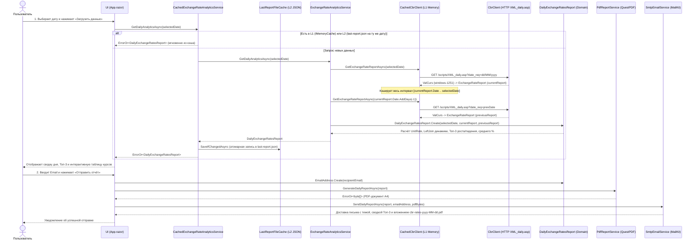
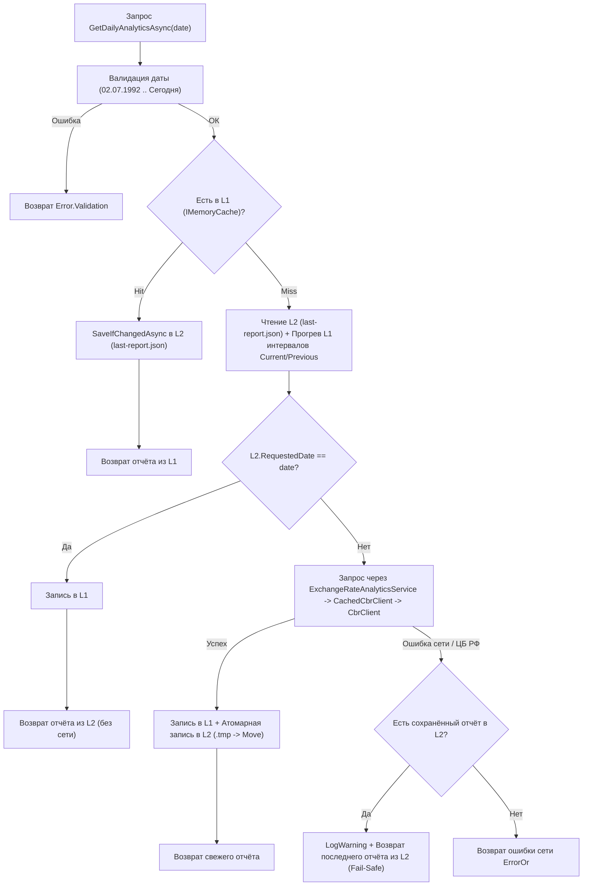

# Курсы валют ЦБ РФ — Аналитика, PDF-отчёты и рассылка по SMTP

Десктопное приложение на платформе **.NET 8 (`Photino.Blazor`)** для загрузки официальных курсов валют Центрального банка РФ, расчёта аналитики динамики относительно предыдущего доступного дня котировок, генерации **PDF-отчёта (`QuestPDF`)** и его отправки по **электронной почте (`MailKit` / SMTP)** с поддержкой двухуровневого кэширования, работы в офлайн-режиме (**Fail-Safe**) и структурированного файлового логирования (**`Serilog`**).

---

## Содержание

1. [Матрица выполнения требований ТЗ](#1-матрица-выполнения-требований-тз)
2. [Быстрый старт и настройка конфигурации](#2-быстрый-старт-и-настройка-конфигурации)
3. [Полный сценарий работы: от выбора даты до получения письма с PDF](#3-полный-сценарий-работы-от-выбора-даты-до-получения-письма-с-pdf)
4. [Архитектура решения и публичный API Core](#4-архитектура-решения-и-публичный-api-core)
5. [Качество кода Core, обработка ошибок и подводные камни](#5-качество-кода-core-обработка-ошибок-и-подводные-камни)
6. [Выполненные дополнительные задания (технический разбор)](#6-выполненные-дополнительные-задания-технический-разбор)
7. [Использованные библиотеки и обоснование выбора](#7-использованные-библиотеки-и-обоснование-выбора)

---

## 1. Матрица выполнения требований ТЗ

| Раздел ТЗ | Требование | Статус и реализация в проекте |
|---|---|---|
| **2. Архитектура** | Чёткое разделение на `Core` и `UI`; `UI` не содержит бизнес-логики и вызывает только публичный API `Core` | Выполнено. Все внутренние сервисы, HTTP-клиент, декораторы кэша, промежуточные модели, DTO и `Options` скрыты модификатором `internal`. В `UI` вынесено только отображение и вызовы `IExchangeRateAnalyticsService`, `IPdfReportService`, `IEmailService`. |
| **3.1. Загрузка данных** | Загрузка с `XML_daily.asp?date_req=dd/MM/yyyy` (`windows-1251`) на выбранную дату и предыдущий доступный день по атрибуту `ValCurs.Date` | Выполнено в `CbrClient` и `ExchangeRateAnalyticsService`. Предыдущий срез запрашивается строго от фактической даты котировки: `currentReport.Date.AddDays(-1)`. |
| **3.2. Обработка данных** | Приведение курса к 1 единице валюты с учётом номинала и запятой, расчёт изменения в %, Топ-3 роста и Топ-3 падения | Выполнено в доменных моделях `CurrencyRate`, `CurrencyRateDynamics` и `DailyExchangeRatesReport` (через кастомный `LeftJoin` по валютам). |
| **3.3. Интерфейс** | Выбор даты (≤ сегодня), таблица результатов, поле email, кнопки «Загрузить данные» и «Отправить отчёт», индикация этапов | Выполнено в `UI/App.razor`. Дополнительно реализованы поиск по коду/названию, сортировка по всем 6 колонкам, кнопка локального сохранения PDF и пошаговый индикатор прогресса (`1. Загрузка` → `2. Формирование PDF` → `3. Отправка`). |
| **3.4. PDF-отчёт** | Заголовок, дата отчёта, блок «Итоги дня» (Топ-3 роста, Топ-3 падения, среднее изменение), таблица всех валют | Выполнено в `PdfReportService` на базе `QuestPDF` с цветовой индикацией динамики и постраничной нумерацией. |
| **3.5. Отправка письма** | Тема `«Курсы валют ЦБ РФ на {дата}»`, текстовая сводка Топ-3 в теле письма, PDF во вложении | Выполнено в `SmtpEmailService` на базе `MailKit` / `MimeKit`. |
| **4. Обработка ошибок** | Перехват ошибок сети ЦБ РФ, пустого/битого XML, невалидного email, ошибок SMTP, отсутствия/порчи `config.json` без падения приложения | Выполнено через паттерн Result (`ErrorOr<T>`), гранулярный перехват сетевых/протокольных исключений и безопасную инициализацию конфигурации при старте. |
| **5. Конфигурация** | Параметры в `config.json` (вне Git), наличие шаблона `config.example.json` в репозитории | Выполнено (`UI/config.example.json` в репозитории, `config.json` в `.gitignore`). Добавлена декларативная валидация `DataAnnotations` + Source Generator. |
| **7.1. Доп. задание №1** | Кэширование последних загруженных данных с возможностью сформировать отчёт без подключения к сети | **Выполнено.** Двухуровневый кэш (**L1 `IMemoryCache`** + **L2 `cache/last-report.json`**) с атомарной записью, прогревом памяти, режимом **Fail-Safe** и офлайн-сохранением PDF. |
| **7.2. Доп. задание №2** | Логирование операций в файл | **Выполнено.** Структурированное логирование через **`Serilog`** (`logs/app-YYYYMMDD.log`) с ежедневной ротацией и фильтрацией системного шума. |

---

## 2. Быстрый старт и настройка конфигурации

### Предварительные требования
- Установленный **[.NET 8.0 SDK](https://dotnet.microsoft.com/download/dotnet/8.0)** (или новее с поддержкой таргета `net8.0`).
- ОС **Windows 10 / 11** (с системным компонентом Microsoft Edge WebView2 Runtime, предустановленным в современных версиях Windows).

### Шаг 1. Создание рабочего `UI/config.json` из шаблона

Реальный конфигурационный файл `UI/config.json` добавлен в [`.gitignore`](./.gitignore), чтобы пароли SMTP не попадали в систему контроля версий. В репозитории находится готовый шаблон [`UI/config.example.json`](./UI/config.example.json).

Скопируйте шаблон в рабочий файл конфигурации:

```powershell
Copy-Item UI/config.example.json UI/config.json
```

Откройте `UI/config.json` и укажите параметры вашей учётной записи SMTP:

```json
{
  "CbrClient": {
    "BaseUrl": "https://www.cbr.ru/",
    "Timeout": "00:00:10"
  },
  "Cache": {
    "SlidingExpiration": "06:00:00",
    "AbsoluteExpiration": "1.00:00:00",
    "FilePath": "cache/last-report.json"
  },
  "Smtp": {
    "Host": "smtp.yandex.ru",
    "Port": 465,
    "Username": "your-login@yandex.ru",
    "Password": "your-app-password",
    "SenderEmail": "your-login@yandex.ru",
    "Timeout": "00:00:15"
  }
}
```

#### Справочник параметров конфигурации и правил валидации (`DataAnnotations`)

| Секция | Параметр | Тип / Формат | Значение по умолчанию | Ограничения валидации и описание |
|---|---|---|---|---|
| `CbrClient` | `BaseUrl` | `string` (URL) | `"https://www.cbr.ru/"` | `[Required, Url]`. Базовый адрес XML-сервиса Банка России. |
| `CbrClient` | `Timeout` | `TimeSpan` | `"00:00:10"` | `[Range("00:00:01", "00:02:00")]`. Таймаут одного HTTP-запроса к ЦБ РФ. |
| `Cache` | `SlidingExpiration` | `TimeSpan` | `"06:00:00"` | `[Range("00:01:00", "1.00:00:00")]`. Скользящее время жизни записей в `IMemoryCache` (от 1 мин до 1 суток). |
| `Cache` | `AbsoluteExpiration` | `TimeSpan` | `"1.00:00:00"` | `[Range("00:01:00", "7.00:00:00")]`. Абсолютное время жизни записей в `IMemoryCache` (от 1 мин до 7 суток). |
| `Cache` | `FilePath` | `string` | `"cache/last-report.json"` | `[Required]`. Относительный (от `AppContext.BaseDirectory`) или абсолютный путь к файлу L2-кэша. |
| `Smtp` | `Host` | `string` | `"smtp.yandex.ru"` | `[Required]`. Адрес SMTP-сервера (`smtp.yandex.ru`, `smtp.mail.ru`, `smtp.gmail.com` и др.). |
| `Smtp` | `Port` | `int` | `465` (или `587`) | `[Range(1, 65535)]`. Порт SMTP. Шифрование (`SSL/TLS` или `STARTTLS`) выбирается автоматически через `SecureSocketOptions.Auto`. |
| `Smtp` | `Username` | `string` | — | `[Required]`. Логин почтового ящика (полный email-адрес). |
| `Smtp` | `Password` | `string` | — | `[Required]`. **Пароль приложения (App Password)** почтового провайдера. |
| `Smtp` | `SenderEmail` | `string` (Email) | — | `[Required, EmailAddress]`. Адрес отправителя в заголовке `From` (должен совпадать с аккаунтом `Username`). |
| `Smtp` | `Timeout` | `TimeSpan` | `"00:00:15"` | `[Range("00:00:01", "00:02:00")]`. Таймаут подключения и отправки письма по SMTP. |

> [!TIP]
> **Как настроить SMTP для Яндекс Почты / Mail.ru / Gmail:**
> Почтовые сервисы требуют использовать **пароль приложения**, а не основной пароль от аккаунта:
> - **Яндекс (`smtp.yandex.ru`, порт `465` или `587`):** *Управление аккаунтом (Яндекс ID) → Безопасность → Пароли приложений → Создать пароль приложения (Почта)*.
> - **Mail.ru (`smtp.mail.ru`, порт `465`):** *Настройки → Безопасность → Пароли для внешних приложений*.
> - **Gmail (`smtp.gmail.com`, порт `587` или `465`):** *Аккаунт Google → Безопасность → Двухэтапная аутентификация → Пароли приложений*.

### Шаг 2. Сборка и запуск приложения

Выполните из корневой папки репозитория:

```powershell
# Сборка решения
dotnet build

# Запуск десктопного приложения
dotnet run --project UI
```

Также решение [`RussianCentralBankExchangeRates.slnx`](./RussianCentralBankExchangeRates.slnx) можно открыть и запустить напрямую из **JetBrains Rider** или **Visual Studio 2022+** (стартовый проект — `UI`).

---

## 3. Полный сценарий работы: от выбора даты до получения письма с PDF

Ниже показана полная сквозная цепочка выполнения основного пользовательского сценария через слои приложения:



### Пошаговое описание этапов сценария

1. **Автозагрузка при старте и выбор даты:**
   - При открытии окна приложение автоматически запрашивает курсы на сегодняшнюю дату (`DateTime.Today`).
   - Поле выбора даты ограничено диапазоном от `02.07.1992` (первая историческая котировка в базе ЦБ РФ) до текущей даты (нельзя выбрать дату в будущем).
   - Кнопки **«Сохранить PDF»** и **«Отправить отчёт»** блокируются при смене даты в календаре до тех пор, пока пользователь не нажмёт **«Загрузить данные»**, что исключает отправку старого отчёта при изменённом поле даты.

2. **Загрузка котировок и определение предыдущего торгового дня:**
   - `CbrClient` запрашивает `https://www.cbr.ru/scripts/XML_daily.asp?date_req=dd/MM/yyyy`, декодирует поток из `windows-1251`, десериализует XML в `ValCurs` и преобразует в доменный срез `ExchangeRateReport`.
   - `ExchangeRateAnalyticsService` считывает фактическую дату котировки из `currentReport.Date` (атрибут `Date` корневого элемента `<ValCurs>`) и запрашивает предыдущий доступный срез на дату `currentReport.Date.AddDays(-1)`.

3. **Доменный расчёт аналитики (`DailyExchangeRatesReport.Create`):**
   - Для каждой валюты курс приводится к **1 единице валюты** (`UnitRate`): используется высокоточное поле `<VunitRate>` из XML ЦБ РФ, а при его отсутствии в архивных выгрузках выполняется фолбэк `Value / Nominal`.
   - Текущий и предыдущий срезы сопоставляются через кастомный `LeftJoin` по сущности `Currency`.
   - В `CurrencyRateDynamics.Create` вычисляются абсолютное изменение (`CurrentUnitRate - PreviousUnitRate`) и процентное изменение с округлением до 4 знаков после запятой:

     $$\text{PercentChange} = \text{round}\left(\frac{\text{CurrentUnitRate} - \text{PreviousUnitRate}}{\text{PreviousUnitRate}} \times 100, 4\right)$$

   - Формируются списки **Топ-3 выросших валют** (`PercentChange > 0`, по убыванию), **Топ-3 упавших валют** (`PercentChange < 0`, по возрастанию) и **среднее изменение по всем валютам** (`AveragePercentChange`).

4. **Отображение в UI и интерактивная работа с таблицей:**
   - Во время выполнения любой операции отображается панель прогресса со спиннером и активным шагом (`1. Загрузка` → `2. Формирование PDF` → `3. Отправка`).
   - На экране выводятся 3 аналитические карточки («Среднее изменение», «Топ-3 роста», «Топ-3 падения») и полная таблица курсов.
   - Таблица поддерживает **мгновенный поиск** по символьному коду (`USD`, `EUR`, `CNY`) или названию валюты и **сортировку в оба направления** по любому из 6 столбцов.

5. **Формирование PDF-отчёта (`PdfReportService`):**
   - Генерируется документ формата A4 (шрифт `Arial`, отступы `1.5 см`) со следующей структурой:
     - **Шапка:** заголовок «Отчёт по курсам валют ЦБ РФ» и строка дат (с явным указанием запрошенной даты, даты действующего курса ЦБ РФ и даты предыдущего среза для сравнения).
     - **Блок «Итоги дня»:** среднее изменение по всем валютам и две колонки с Топ-3 роста (зелёный акцент) и Топ-3 падения (красный акцент) с указанием изменения в `%` и в рублях.
     - **Таблица всех валют:** 6 колонок (`Код`, `Валюта`, `Курс (руб.)`, `Пред. (руб.)`, `Изм. (руб.)`, `Изм. (%)`) с цветовой индикацией знака и сквозной нумерацией страниц в колонтитуле (`Страница X из Y`).
   - Отчёт можно как сразу сохранить локально кнопкой **«Сохранить PDF»**, так и отправить по почте.

6. **Отправка письма по SMTP (`SmtpEmailService`):**
   - Адрес получателя валидируется через доменный Value Object `EmailAddress.Create`.
   - Собирается `MimeMessage` с темой `Курсы валют ЦБ РФ на {CurrentDate:dd.MM.yyyy}`, текстовым телом со сводкой Топ-3 роста и Топ-3 падения и прикреплённым PDF-файлом `cbr-rates-{CurrentDate:yyyy-MM-dd}.pdf`.

### Рекомендуемые даты для быстрой проверки особых случаев
- **Любое воскресенье или праздничный день (например, `05.01.2025`):** демонстрация корректного определения действующего курса ЦБ РФ (от `29.12.2024`) и предыдущего торгового дня (от `28.12.2024`) с выводом информационного баннера о нерабочем дне.
- **`19.01.2023`:** день, когда ЦБ РФ добавил в перечень сразу 9 новых валют (`AED`, `THB`, `VND`, `RSD`, `NZD`, `EGP`, `IDR`, `QAR`, `GEL`). Для новых валют в колонках предыдущего курса и изменения корректно отображается прочерк `-` без сбоев в расчёте Топ-3.
- **Отключение интернета после загрузки:** демонстрация работы **Fail-Safe** режима и сохранения PDF-отчёта полностью офлайн.

---

## 4. Архитектура решения и публичный API `Core`

Решение спроектировано по принципам **Clean Architecture** и **Rich Domain Model** с жёстким разделением между библиотекой бизнес-логики (`Core`) и десктопным представлением (`UI`).

### Дерево структуры проектов

```text
russian-central-bank-exchange-rates/
├── .gitignore                                      # Исключает UI/config.json, bin/, obj/, logs/, cache/
├── Makefile                                        # Команда кодогенерации XML DTO из XSD-схемы (xscgen)
├── README.md                                       # Документация проекта
├── RussianCentralBankExchangeRates.slnx            # Файл решения (.NET 8)
├── Core/                                           # Библиотека бизнес-логики и инфраструктуры
│   ├── Core.csproj
│   ├── DependencyInjection.cs                      # Единственная точка входа для регистрации сервисов (AddCoreServices)
│   ├── Domain/
│   │   ├── Helpers/
│   │   │   └── LinqExtensions.cs                   # internal: обобщённый оператор LeftJoin
│   │   └── Models/
│   │       ├── Currency.cs                         # public: Value Object валюты (NumCode, CharCode, Name)
│   │       ├── CurrencyRate.cs                     # internal: Value Object курса за 1 ед. валюты
│   │       ├── ExchangeRateReport.cs               # internal: Value Object дневного среза котировок ЦБ РФ
│   │       ├── CurrencyRateDynamics.cs             # public: Value Object расчёта изменений по валюте
│   │       ├── DailyExchangeRatesReport.cs         # public: Агрегат итогового аналитического отчёта
│   │       └── EmailAddress.cs                     # public: Value Object email-адреса с глубокой валидацией
│   ├── Services/
│   │   ├── ICbrClient.cs                           # internal: интерфейс клиента к API ЦБ РФ
│   │   ├── IExchangeRateAnalyticsService.cs        # public: интерфейс получения аналитического отчёта
│   │   ├── IPdfReportService.cs                    # public: интерфейс генерации PDF-документа
│   │   ├── IEmailService.cs                        # public: интерфейс отправки отчёта по электронной почте
│   │   └── ExchangeRateAnalyticsService.cs         # internal: сервис загрузки срезов и сборки отчёта
│   └── Infrastructure/
│       ├── CbrClient.cs                            # internal: HTTP-клиент к XML_daily.asp (windows-1251)
│       ├── CachedCbrClient.cs                      # internal: L1-декоратор кэширования срезов ЦБ РФ
│       ├── CachedExchangeRateAnalyticsService.cs   # internal: L1/L2-декоратор кэширования отчётов + Fail-Safe
│       ├── LastReportFileCache.cs                  # internal: потокобезопасное хранилище last-report.json
│       ├── PdfReportService.cs                     # internal: вёрстка PDF-отчёта на QuestPDF
│       ├── SmtpEmailService.cs                     # internal: отправка письма с PDF через MailKit
│       ├── CbrClientOptions.cs                     # internal: настройки HTTP-клиента ЦБ РФ
│       ├── CacheOptions.cs                         # internal: настройки времени жизни и пути кэша
│       ├── SmtpOptions.cs                          # internal: настройки подключения к SMTP-серверу
│       ├── schema.xsd                              # XSD-схема ответа ЦБ РФ
│       ├── Dto/                                    # internal/EditorBrowsable(Never): XML и JSON Cache DTO
│       ├── Helpers/
│       │   └── FormattingExtensions.cs             # public: единые методы форматирования для PDF, Email и UI
│       └── Mappers/
│           ├── CbrMapperExtensions.cs              # internal: маппинг XML DTO -> Domain
│           └── CacheMapperExtensions.cs            # internal: маппинг Domain <-> JSON Cache DTO
└── UI/                                             # Десктопное приложение Photino.Blazor
    ├── UI.csproj
    ├── Program.cs                                  # Инициализация окна Photino, Serilog и чтения config.json
    ├── App.razor                                   # UI-компонент отображения отчёта и управления операциями
    ├── _Imports.razor
    ├── config.example.json                         # Шаблон конфигурации
    └── wwwroot/
        ├── index.html
        └── css/app.css
```

### Инкапсуляция и граница публичного API `Core`

В соответствии с п. 2 и п. 9 ТЗ (*«Чёткое разделение Core/UI, понятный публичный API Core»*), проект `Core` закрывает все детали реализации модификатором `internal`. Снаружи библиотеки доступны **только** следующие типы:

| Категория | Публичный API `Core` (`public`) | Скрытая реализация внутри `Core` (`internal`) |
|---|---|---|
| **Регистрация в DI** | `DependencyInjection.AddCoreServices(IServiceCollection, IConfiguration)` | Настройка `QuestPDF`, привязка и валидация `CbrClientOptions`, `SmtpOptions`, `CacheOptions`, регистрация `HttpClient`, `XmlSerializer` и цепочки декораторов. |
| **Сервисные контракты** | `IExchangeRateAnalyticsService`<br>`IPdfReportService`<br>`IEmailService` | `ICbrClient`, `CbrClient`, `CachedCbrClient`, `ExchangeRateAnalyticsService`, `CachedExchangeRateAnalyticsService`, `LastReportFileCache`, `PdfReportService`, `SmtpEmailService`. |
| **Доменные модели** | `DailyExchangeRatesReport`<br>`CurrencyRateDynamics`<br>`Currency`<br>`EmailAddress`<br>*(все с `private` конструкторами — `UI` может только читать свойства отчёта и вызывать `EmailAddress.Create`)* | `ExchangeRateReport`, `CurrencyRate`, а также все фабричные методы `DailyExchangeRatesReport.Create`, `CurrencyRateDynamics.Create`, `Currency.Create`, `ValidateRequestedDate`. |
| **Форматирование и DTO** | `FormattingExtensions` *(единое форматирование курсов, процентов, дат и имени PDF-файла)* | `CbrMapperExtensions`, `CacheMapperExtensions`, `LinqExtensions`, `LastDailyExchangeRatesReportCacheDto`, `ExchangeRateReportCacheDto`, `CurrencyRateCacheDto`, `LastDailyExchangeRatesReportCacheJsonContext`. |

Такой дизайн гарантирует на уровне компилятора C#, что слой `UI` физически не может обойти валидацию, напрямую обратиться к `HttpClient` или `IMemoryCache`, вручную сконструировать фальшивый `DailyExchangeRatesReport` или изменить бизнес-правила расчёта.

---

## 5. Качество кода `Core`, обработка ошибок и подводные камни

### 5.1. Обработка ошибок без необработанных исключений (п. 4 ТЗ)

В проекте комбинируются два подхода:
1. **Внутри бизнес-логики и доменной модели** исключения не используются для управления потоком выполнения — все фабрики и сервисные методы возвращают дискриминированное объединение **`ErrorOr<T>`**.
2. **На границах инфраструктуры** (`HttpClient`, `XmlSerializer`, `MailKit`, `QuestPDF`, `File IO`, `IOptions`) все специфичные исключения перехватываются, логируются через `ILogger<T>` с полным контекстом и преобразуются в типизированный `Error.Failure` / `Error.Validation` / `Error.NotFound` с понятным сообщением для пользователя:

| Ситуация из п. 4 ТЗ | Где перехватывается | Какие ошибки и исключения обрабатываются | Поведение приложения |
|---|---|---|---|
| **Отсутствие сети или недоступность сайта ЦБ РФ** | `CbrClient`<br>`CachedExchangeRateAnalyticsService` | `HttpRequestException`, `TaskCanceledException` (таймаут `CbrClientOptions.Timeout` vs отмена пользователем), не-2xx HTTP-статусы | При наличии кэша на диске автоматически включается **Fail-Safe** режим (возвращается последний сохранённый отчёт с предупреждающим баннером). Если кэша ещё нет — выводится понятное сообщение о недоступности сайта ЦБ РФ. |
| **Некорректный или пустой ответ сервиса ЦБ РФ** | `CbrClient`<br>`CbrMapperExtensions`<br>`ExchangeRateReport.Create` | Пустой поток, `InvalidOperationException` внутри `XmlSerializer`, некорректный формат даты, пустой список `<Valute>`, нулевой номинал, непарсящийся курс, дубликаты валют | Ошибка логируется в файл, пользователю выводится точное описание проблемы без падения приложения. |
| **Некорректный адрес получателя** | `EmailAddress.Create` | Пустая строка (`"Не указан email-адрес получателя."`), несоответствие `EmailAddressAttribute`, ошибка `MailboxAddress.TryParse`, попытка подстановки отображаемого имени (`Display Name Injection`) | Валидация полностью делегирована в `Core` (`EmailAddress.Create`): при пустом или некорректном адресе в `SendReportAsync` мгновенно возвращается `Error.Validation` и выводится сообщение об ошибке **до** запуска генерации PDF и обращения к SMTP. |
| **Ошибка отправки по SMTP** | `SmtpEmailService` | `AuthenticationException`, `SaslException` (неверный логин/пароль приложения), `SslHandshakeException` (ошибка TLS), `SmtpCommandException` (отказ сервера принять адрес), `TimeoutException`, `SocketException`, `SmtpProtocolException` | Для каждого типа сбоя возвращается адресное сообщение (например, рекомендация проверить пароль приложения при ошибке авторизации или порт при ошибке TLS). |
| **Отсутствующий или некорректный `config.json`** | `UI/Program.cs`<br>`CbrClient`<br>`SmtpEmailService`<br>`CachedExchangeRateAnalyticsService` | `FileNotFoundException`, `InvalidDataException`, `FormatException` при старте; `OptionsValidationException` при обращении к `options.Value` | Приложение **не падает при запуске** даже при удалённом или синтаксически битом `config.json`: создаётся `StartupConfigState`, показывается системное диалоговое окно и баннер с подсказкой скопировать `config.example.json`. |

### 5.2. Подводные камни и как они были решены

#### 1. Поиск предыдущего дня по `ValCurs.Date`, а не по календарю
- **Проблема:** ЦБ РФ не публикует котировки по выходным и официальным праздникам. Если в воскресенье (`11.10.2026`) запросить курс, ЦБ РФ вернёт срез со штампом субботы `<ValCurs Date="10.10.2026">`. Если искать предыдущий день по календарю (`requestedDate.AddDays(-1)` = `10.10.2026`), то и за текущий, и за предыдущий день вернётся один и тот же субботний срез, а динамика по всем валютам станет `0,0000%` (или сработает ошибка валидации дат). Аналогично в новогодние праздники (`01.01`–`08.01`) курс не меняется целую неделю.
- **Решение:** В [`ExchangeRateAnalyticsService.cs`](./Core/Services/ExchangeRateAnalyticsService.cs) целевая дата предыдущего среза всегда отсчитывается от **фактической даты котировки**, полученной из атрибута `Date` корневого элемента `<ValCurs>`:
  ```csharp
  var prevTargetDate = currentReport.Date.AddDays(-1);
  ```
  Это гарантирует нахождение реального предшествующего торгового дня при любой длительности выходных или праздников.

#### 2. Интервальное кэширование нерабочих дней (`CacheReportInterval`)
- **Проблема:** Когда на запрос за понедельник (`19.01`) ЦБ РФ возвращает курс, установленный в субботу (`17.01`), обычное кэширование по ключу запрошенной даты сохранило бы ответ только под ключом `19.01`. При переключении пользователя на `18.01` или `17.01` произошёл бы лишний сетевой запрос за тем же самым XML.
- **Решение:** Метод [`CachedCbrClient.CacheReportInterval`](./Core/Infrastructure/CachedCbrClient.cs) при обнаружении `report.Date < requestedDate` кэширует полученный `ExchangeRateReport` сразу для всех календарных дней диапазона `[report.Date .. requestedDate]`.

#### 3. Появление новых валют в выгрузке ЦБ РФ (кейс `19.01.2023`) и фолбэк `VunitRate`
- **Проблема:** 19 января 2023 года Банк России расширил перечень котируемых валют сразу на 9 позиций (дирхам ОАЭ, таиландский бат, вьетнамский донг и др.), которых не было в XML за 18 января 2023 года. Кроме того, в ранних исторических выгрузках ЦБ РФ (начиная с `02.07.1992`) мог отсутствовать элемент `<VunitRate>`.
- **Решение:**
  - Сопоставление валют в [`DailyExchangeRatesReport.Create`](./Core/Domain/Models/DailyExchangeRatesReport.cs) реализовано через кастомный оператор `LeftJoin` ([`LinqExtensions.cs`](./Core/Domain/Helpers/LinqExtensions.cs)). Если в предыдущем дне валюта отсутствовала (`previous is null`), `CurrencyRateDynamics.Create` присваивает `PreviousUnitRate = null`, `AbsoluteChange = null` и `PercentChange = null`. Такие валюты отображаются в таблице с прочерком `-` и не искажают расчёт Топ-3 и среднего процента изменения.
  - В [`CbrMapperExtensions.cs`](./Core/Infrastructure/Mappers/CbrMapperExtensions.cs) и [`CurrencyRate.cs`](./Core/Domain/Models/CurrencyRate.cs) реализован двойной разбор курса: приоритетно берётся `<VunitRate>`, а если он отсутствует — курс вычисляется как `Value / Nominal` с использованием культуры `ru-RU` (десятичный разделитель — запятая).

#### 4. Кодировка `windows-1251`, XSD-схема и управление памятью `XmlSerializer`
- **Проблема:** В .NET Core / .NET 8 кодовая страница `windows-1251` не включена в стандартный набор кодировок, а динамическое создание `XmlSerializer` с дополнительными параметрами на каждый вызов не кэширует сгенерированные сборки в памяти.
- **Решение:** В статическом конструкторе `CbrClient` регистрируется `CodePagesEncodingProvider.Instance`, классы DTO (`ValCurs`, `ValCursValute`) строго типизированы по схеме [`schema.xsd`](./Core/Infrastructure/schema.xsd) через `XmlSchemaClassGenerator` и скрыты из IntelliSense атрибутом `[EditorBrowsable(EditorBrowsableState.Never)]`, а экземпляр `XmlSerializer(typeof(ValCurs))` зарегистрирован в DI-контейнере как `Singleton`.

#### 5. Нюанс C# Source Generator `<EnableConfigurationBindingGenerator>` и `TimeSpan` в `[Range]`
- **Проблема:**
  1. При включённом генераторе привязки конфигурации `<EnableConfigurationBindingGenerator>true</EnableConfigurationBindingGenerator>` компилятор генерирует метод `BindCore(IConfiguration, ref T instance, ...)`. Если свойства в классах `Options` имеют аксессор `{ get; init; }`, сгенерированный код не может перезаписать свойства уже созданного объекта `instance` и генерирует пустое тело метода, оставляя `BaseUrl` и настройки `Smtp` пустыми.
  2. В атрибуте `[Range(typeof(TimeSpan), "00:01:00", "24:00:00")]` запись `"24:00:00"` вызывает `FormatException` внутри `TimeSpan.Parse`, так как сегмент часов принимает значения только от `0` до `23`.
- **Решение:** Во всех классах настроек (`CbrClientOptions`, `CacheOptions`, `SmtpOptions`) используются свойства `{ get; set; }`, а суточные интервалы в `[Range]` записаны в каноничном формате `d.hh:mm:ss` (`"1.00:00:00"` и `"7.00:00:00"`).

#### 6. Структурное равенство (`SequenceEqual`) в `record` с коллекциями и защита Email
- **Проблема:** Стандартная реализация `Equals` в C# `record` сравнивает свойства типа `IReadOnlyList<T>` по ссылке (`ReferenceEquals`), а не по элементам. Кроме того, стандартный `MailboxAddress.TryParse` допускает строки вида `"Hacker <victim@mail.ru>"`.
- **Решение:** В `ExchangeRateReport` и `DailyExchangeRatesReport` переопределены `Equals` и `GetHashCode` с поэлементным сравнением через `SequenceEqual`. В `EmailAddress.Create` помимо `EmailAddressAttribute` и `MailboxAddress.TryParse` проверяется строгое совпадение `mailbox.Address == trimmed`, что полностью блокирует Display-Name и Header Injection.

---

## 6. Выполненные дополнительные задания (технический разбор)

### 6.1. Кэширование последних загруженных данных и формирование отчёта без подключения к сети

Система кэширования построена на **паттерне Decorator** поверх сервисов `ICbrClient` и `IExchangeRateAnalyticsService` и сочетает быстрый кэш в оперативной памяти (**L1 `IMemoryCache`**), персистентный файловый кэш на диске (**L2 `cache/last-report.json`**) и автоматический режим отказоустойчивости (**Fail-Safe**).



#### Два сценария офлайн-работы (отображение на UI + генерация PDF):

1. **Сценарий А — Офлайн в рамках текущей сессии (из `IMemoryCache`, уровень L1):**
   - Во время работы приложения все загруженные аналитические отчёты кэшируются в памяти под ключами `cbr:daily-analytics:{yyyy-MM-dd}`, а сырые срезы котировок ЦБ РФ — под ключами `cbr:exchange-rates:{yyyy-MM-dd}` (причём метод `CachedCbrClient.CacheReportInterval` сразу заполняет весь диапазон нерабочих/праздничных дней `[report.Date .. requestedDate]`).
   - Если интернет пропадает во время работы приложения:
     - При повторном выборе любой ранее просмотренной даты `CachedExchangeRateAnalyticsService.TryGetFromMemoryCache` мгновенно возвращает `DailyExchangeRatesReport` из `IMemoryCache` (и синхронизирует `last-report.json` через `SaveIfChangedAsync`).
     - Более того, если пользователь выберет дату внутри уже закэшированного праздничного/выходного интервала, оба среза (`CurrentReport` и `PreviousReport`) будут взяты декоратором `CachedCbrClient` напрямую из `IMemoryCache`, и `ExchangeRateAnalyticsService` соберёт полный отчёт в памяти без единого обращения к сети.
     - На **UI** полноценно отображаются карточки итогов дня (топ-3 роста, топ-3 падения, среднее изменение) и интерактивная таблица валют с фильтрацией и сортировкой, а нажатие кнопки **«Сохранить PDF»** (`SavePdfReportAsync`) передаёт закэшированный в памяти `DailyExchangeRatesReport` в `PdfReportService.GenerateDailyReportAsync` и генерирует PDF-файл полностью офлайн.

2. **Сценарий Б — Офлайн после перезапуска приложения (из файла `cache/last-report.json`, уровень L2 + Fail-Safe):**
   - После полного закрытия и повторного запуска приложения оперативный кэш `IMemoryCache` пуст.
   - При первом же запросе `CachedExchangeRateAnalyticsService` обращается к `LastReportFileCache.GetAsync()`, десериализует `cache/last-report.json` и методом `TryRestoreFromDiskCache` **прогревает `IMemoryCache`** (восстанавливая в памяти интервалы `CurrentReport` и `PreviousReport`).
   - Если запрошенная дата совпадает с датой в `last-report.json` (`diskReport.RequestedDate == date`), отчёт сразу возвращается из файла и кэшируется в `IMemoryCache` без обращения к сети.
   - Если пользователь запрашивает новую дату при отсутствии интернета, сетевой вызов возвращает ошибку `CbrClient.NetworkError`, после чего срабатывает механизм **`GetFailSafeOrError`**: сервис перехватывает ошибку сети, логирует предупреждение и возвращает восстановленный из `last-report.json` отчёт (`diskReport`).
   - На **UI** отрисовывается полный сохранённый отчёт вместе с информационным баннером (*«Автономный режим (нет связи с сервером ЦБ РФ): не удалось загрузить данные на выбранную дату {loadedForDate}. Отображён последний сохранённый в кэше отчёт...»*), а кнопка **«Сохранить PDF»** (`SavePdfReportAsync`) генерирует полноценный PDF-документ из восстановленного файлового кэша и сохраняет его через нативный диалог ОС.

#### Технические детали реализации:
1. **Декоратор `CachedCbrClient` (L1 для XML-срезов ЦБ РФ):**
   - Кэширует объекты `ExchangeRateReport` в `IMemoryCache` под ключами `cbr:exchange-rates:{yyyy-MM-dd}` с комбинированной политикой вытеснения (`SlidingExpiration` + `AbsoluteExpirationRelativeToNow` из `CacheOptions`).
   - Заполняет сразу весь диапазон нерабочих дат `[report.Date .. requestedDate]` методом `CacheReportInterval`.
2. **Декоратор `CachedExchangeRateAnalyticsService` и `LastReportFileCache` (L1 + L2 для аналитического отчёта):**
   - **AOT-дружественная сериализация без рефлексии:** для записи и чтения `last-report.json` используется генератор исходного кода `System.Text.Json` (`[JsonSerializable(typeof(LastDailyExchangeRatesReportCacheDto))]` в [`LastDailyExchangeRatesReportCacheJsonContext.cs`](./Core/Infrastructure/Dto/LastDailyExchangeRatesReportCacheJsonContext.cs)).
   - **Нормализованное хранение и повторная валидация инвариантов:** в JSON-файл сохраняются только `RequestedDate` и два исходных среза котировок (`CurrentReport`, `PreviousReport`), без дублирования вычисляемых коллекций. При загрузке с диска маппер [`CacheMapperExtensions.ToDomain`](./Core/Infrastructure/Mappers/CacheMapperExtensions.cs) заново проводит данные через всю цепочку доменных фабрик (`Currency.Create` → `CurrencyRate.Create` → `ExchangeRateReport.Create` → `DailyExchangeRatesReport.Create`). Если файл кэша был повреждён или изменён вручную с нарушением инвариантов, он отбраковывается с записью `Warning` в лог.
   - **Атомарная потокобезопасная запись (`SaveIfChangedAsync`):** конкурентный доступ синхронизируется через `SemaphoreSlim(1, 1)`. Чтобы исключить повреждение файла при внезапном завершении процесса или отключении питания, запись сначала производится во временный файл `last-report.json.tmp`, после чего выполняется атомарная замена `File.Move(tempPath, cacheFilePath, overwrite: true)` с гарантированной очисткой `.tmp` в блоке `finally`.

---

### 6.2. Структурированное логирование операций в файл (`Serilog`)

1. **Архитектура и конфигурация (`UI/Program.cs`):**
   - Все сервисы в `Core` используют стандартный интерфейс `Microsoft.Extensions.Logging.ILogger<T>`, не создавая жёсткой привязки к конкретной библиотеке логирования.
   - В точке входа [`UI/Program.cs`](./UI/Program.cs) подключён провайдер **`Serilog`** (`Serilog.Extensions.Logging` + `Serilog.Sinks.File`):
     - Файлы логов пишутся по пути `logs/app-YYYYMMDD.log` относительно базовой директории приложения с ежедневной ротацией (`RollingInterval.Day`).
     - Базовый уровень логирования — `Information`, при этом системные логи от `Microsoft.*` и `System.*` приглушены до `Warning` (`MinimumLevel.Override`), чтобы в лог-файле оставались только значимые события предметной области.
     - Шаблон вывода включает `SourceContext` (полное имя класса), что обеспечивает прозрачную трассировку вызовов между декораторами и сервисами:
       ```text
       {Timestamp:yyyy-MM-dd HH:mm:ss.fff} [{Level:u3}] [{SourceContext}] {Message:lj}{NewLine}{Exception}
       ```
   - Зарегистрирован глобальный обработчик `AppDomain.CurrentDomain.UnhandledException`, который при любой критической ошибке среды выполнения записывает `Log.Fatal` и принудительно сбрасывает файловый буфер через `Log.CloseAndFlush()`.

2. **Сквозное покрытие всех этапов работы:**
   - **HTTP и парсинг (`CbrClient`, `CachedCbrClient`):** старт запроса на дату, попадание в L1-кэш, успешное получение среза (с фактической датой ЦБ РФ и числом валют), ошибки HTTP/сети/таймаута и ошибки десериализации XML.
   - **Аналитика и файловый кэш (`ExchangeRateAnalyticsService`, `CachedExchangeRateAnalyticsService`, `LastReportFileCache`):** расчёт аналитики, чтение и сохранение `last-report.json`, восстановление из L2-кэша, отбраковка невалидного кэш-файла и активация Fail-Safe режима.
   - **PDF и SMTP (`PdfReportService`, `SmtpEmailService`):** начало и успешное завершение генерации PDF с указанием размера документа в байтах, подключение к SMTP-серверу (`Host:Port`), успешная отправка письма получателю и детализация ошибок SMTP/TLS/аутентификации.

---

## 7. Использованные библиотеки и обоснование выбора

### Проект `Core`

| Библиотека / Инструмент | Версия | Назначение в проекте | Обоснование выбора |
|---|---|---|---|
| **[`ErrorOr`](https://github.com/amantinband/error-or)** | `2.1.1` | Result-паттерн (`ErrorOr<T>`) для возврата ошибок из доменных фабрик и сервисов | Позволяет явно описывать ошибки валидации, сети и инфраструктуры в сигнатурах методов без дорогих `throw/catch` в бизнес-логике. |
| **[`QuestPDF`](https://www.questpdf.com/)** | `2026.9.1` | Генерация табличного PDF-отчёта (`PdfReportService`) | Современный декларативный C# Fluent API для вёрстки PDF без необходимости вручную считать координаты текста и таблиц; высокая скорость генерации и встроенная поддержка кириллических системных шрифтов. |
| **[`MailKit`](https://github.com/jstedfast/MailKit)** | `4.18.1` | Отправка писем с PDF-вложением по протоколу SMTP (`SmtpEmailService`) | Индустриальный стандарт для .NET (рекомендован Microsoft взамен устаревшего `System.Net.Mail.SmtpClient`); поддерживает полноценный асинхронный I/O, современные механизмы аутентификации и `SecureSocketOptions.Auto`. |
| **`Microsoft.Extensions.Caching.Memory`** | `8.0.1` | Внутрипроцессное L1-кэширование (`IMemoryCache`) | Стандартный высокопроизводительный потокобезопасный кэш .NET с поддержкой комбинированных политик `SlidingExpiration` и `AbsoluteExpiration`. |
| **`Microsoft.Extensions.Http`** | `8.0.0` | Фабрика `IHttpClientFactory` и типизированный клиент `AddHttpClient<CbrClient>` | Предотвращает исчерпание сокетов (`Socket Exhaustion`) и управляет временем жизни `HttpMessageHandler`. |
| **`Microsoft.Extensions.Options.DataAnnotations`** | `8.0.0` | Валидация классов настроек (`CbrClientOptions`, `CacheOptions`, `SmtpOptions`) | Обеспечивает декларативную проверку конфигурации через атрибуты `[Required]`, `[Url]`, `[EmailAddress]`, `[Range]`. |
| **`Microsoft.Extensions.Configuration.Binder`** | `8.0.0` | Привязка секций `IConfiguration` к строго типизированным классам `Options` | В сочетании с `<EnableConfigurationBindingGenerator>true</EnableConfigurationBindingGenerator>` генерирует код привязки на этапе компиляции без использования рефлексии. |
| **`Microsoft.Extensions.DependencyInjection`** | `8.0.0` | DI-контейнер приложения | Позволяет чисто изолировать регистрацию зависимостей и декораторов внутри `Core.DependencyInjection.AddCoreServices`. |
| **`XmlSchemaClassGenerator` (`xscgen`)** | `3.0.1405` | Генерация C# DTO (`ValCurs`, `ValCursValute`) по схеме `schema.xsd` | Автоматизирует создание строго типизированных классов разбора XML-ответа ЦБ РФ (команда `make dto-gen` в [`Makefile`](./Makefile)). |

### Проект `UI`

| Библиотека | Версия | Назначение в проекте | Обоснование выбора |
|---|---|---|---|
| **[`Photino.Blazor`](https://github.com/tryphotino/photino.Blazor)** | `4.*` | Десктопная оболочка для Blazor поверх системного WebView | В отличие от Electron, использует нативный системный движок ОС (WebView2 на Windows), обеспечивая минимальный размер сборки, мгновенный старт окна и доступ к нативным диалогам ОС (`ShowSaveFileAsync`, `ShowMessage`). |
| **[`Serilog.Extensions.Logging`](https://github.com/serilog/serilog-extensions-logging)** | `8.0.0` | Интеграция `Serilog` с `Microsoft.Extensions.Logging` | Позволяет подключить мощный пайплайн ротации логов `Serilog` в `UI`, сохранив в `Core` чистую зависимость только от стандартного `ILogger<T>`. |
| **[`Serilog.Sinks.File`](https://github.com/serilog/serilog-sinks-file)** | `6.0.0` | Запись структурированных логов в файл | Надёжный файловый приёмник с поддержкой ежедневной ротации (`RollingInterval.Day`), форматирования шаблонов и буферизованного сброса на диск. |